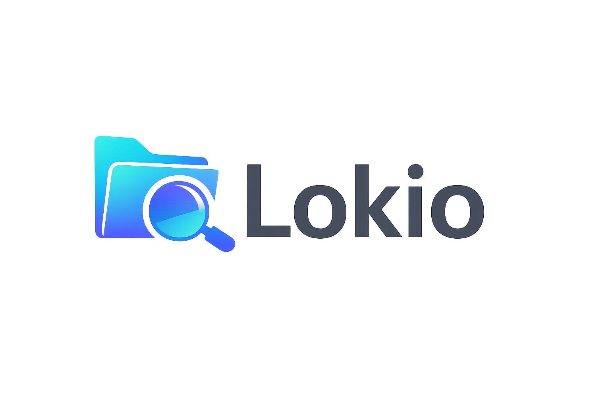

<p align="center">
  
</p>

<h1 align="center">Lokio</h1>

<p align="center">
  A TypeScript-first SDK for building <b>local-first</b> applications on top of plain, user-owned files.
</p>

<p align="center">
  <a href="https://github.com/pikl-cz/lokio/actions/workflows/ci.yml"></a>
  <a href="https://www.npmjs.com/package/@lokio/core"></a>
  <a href="LICENSE"></a>
</p>

> **Applications own the data model. Users own the files. Lokio only provides the bridge.**

Lokio gives you one API for reading, writing, watching and organizing files - in Node, in the browser (a real
folder via the File System Access API, or OPFS), and anywhere else you write an adapter for. It doesn't impose a
file format, a database or a UI framework.

```ts
import { openWorkspace } from "@lokio/auto";

const workspace = await openWorkspace({ root: "./notes" }); // a folder in Node, a picked folder in the browser

await workspace.file("dreams/today.md").write("# Flying over Prague");

workspace.watch((change) => console.log(change.source, change.type, change.path)); // incl. edits from other apps

// read-modify-write under a lock - concurrent updates are never lost
await workspace
  .file("settings.json")
  .updateJSON<{ theme?: string }>((s) => ({ ...s, theme: "dark" }));
```

## Features

- **One API, many runtimes** - Node (`fs/promises`), browsers (File System Access API, OPFS), or your own adapter.
- **Safe by default** - paths can't escape the workspace, atomic writes in Node, typed errors with stable codes.
- **Live** - change events for your own writes and for external edits (other apps, tabs, the user), with echo
  suppression.
- **Concurrency-aware** - locks within the app and across processes/tabs; `updateJSON` never loses an update.
- **Pluggable** - decorate I/O or add APIs with plugins: version history, encryption, full-text search.
- **Testable** - an in-memory adapter, a fake File System Access API, and a conformance suite every adapter passes.
- **Small and dependency-free** - ESM, tree-shakeable, strict TypeScript.

## Packages

| Package                                                  | Description                                                         |
| -------------------------------------------------------- | ------------------------------------------------------------------- |
| [`@lokio/core`](packages/core)                           | Workspace, files, directories, events, locks, errors, plugin API    |
| [`@lokio/node`](packages/node)                           | Adapter for Node.js, Electron and Tauri backends                    |
| [`@lokio/browser`](packages/browser)                     | Adapter for the File System Access API and OPFS, handle persistence |
| [`@lokio/auto`](packages/auto)                           | `openWorkspace()` that picks the right adapter for the runtime      |
| [`@lokio/plugin-history`](packages/plugin-history)       | Keeps previous versions of files                                    |
| [`@lokio/plugin-encryption`](packages/plugin-encryption) | Transparent AES-GCM encryption at rest                              |
| [`@lokio/plugin-search`](packages/plugin-search)         | Diacritics-insensitive full-text search that stays up to date       |
| [`@lokio/testing`](packages/testing)                     | `MemoryAdapter`, adapter conformance suite, fake File System Access |
| [`@lokio/cli`](packages/cli)                             | `lokio init` / `doctor` / `info`                                    |
| [`@lokio/types`](packages/types)                         | Shared types (re-exported by core)                                  |

Start with the [`@lokio/core` README](packages/core) for the full API.

## Examples

See **[USECASES.md](USECASES.md)** for recipes: a dream journal, a Markdown vault, a recipe manager, a wiki, an image
catalog, a kanban board, desktop apps, multi-tab sync, CLI tools, and testing.

- [`examples/node-journal`](examples/node-journal) - a CLI journal with history and search.
- [`examples/browser-notes`](examples/browser-notes) - a notes app on a folder the user picks, with live
  external changes.

## Runtime support

| Runtime            | Adapter                 | Watch | Native move | Cross-process locks |
| ------------------ | ----------------------- | ----- | ----------- | ------------------- |
| Node ≥ 20          | `NodeAdapter`           | ✓     | ✓           | ✓ (lock files)      |
| Chrome / Edge ≥ 86 | `BrowserAdapter.pick()` | ✓¹    | files only² | ✓ (Web Locks)       |
| Modern browsers³   | `BrowserAdapter.opfs()` | ✓¹    | files only² | ✓ (Web Locks)       |
| Tests, previews    | `MemoryAdapter`         | ✓     | ✓           | in-process          |

¹ Where `FileSystemObserver` is available (Chromium 129+). ² Directories fall back to copy + delete.
³ Needs OPFS with `createWritable()` (Chromium, Firefox 111+, Safari 26+). Only Chromium is tested in CI.

## Development

```sh
pnpm install
pnpm check          # lint, typecheck, tests with coverage, build
pnpm test:browser   # conformance suite in real Chromium (run `pnpm exec playwright install chromium` once)
```

See [CONTRIBUTING.md](CONTRIBUTING.md) for the repo layout and guidelines, and [ARCHITECTURE.md](ARCHITECTURE.md) for
the vision and roadmap.

## License

[MIT](LICENSE)
